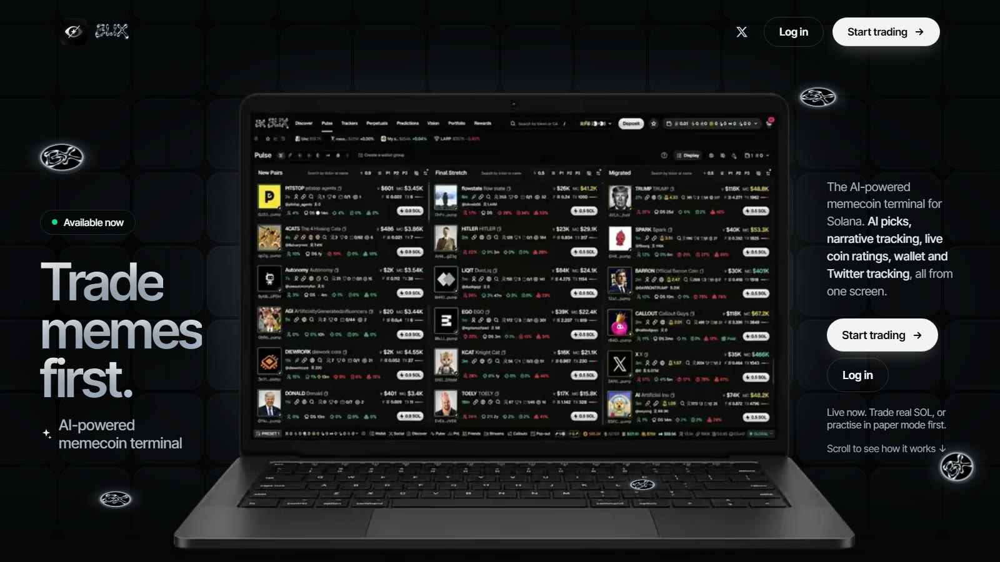
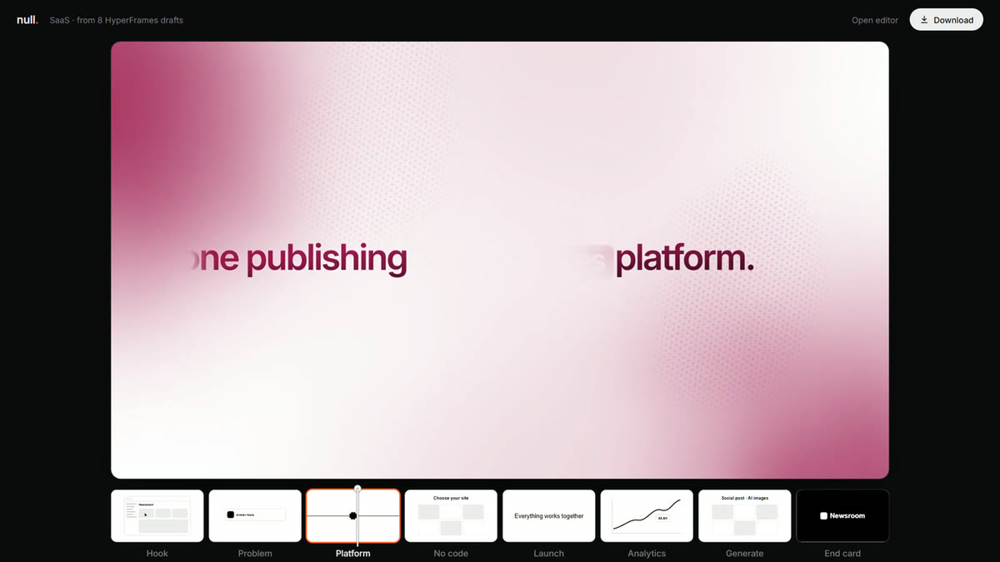
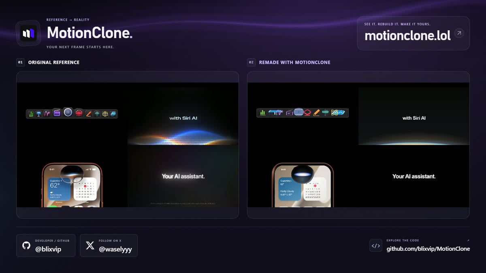
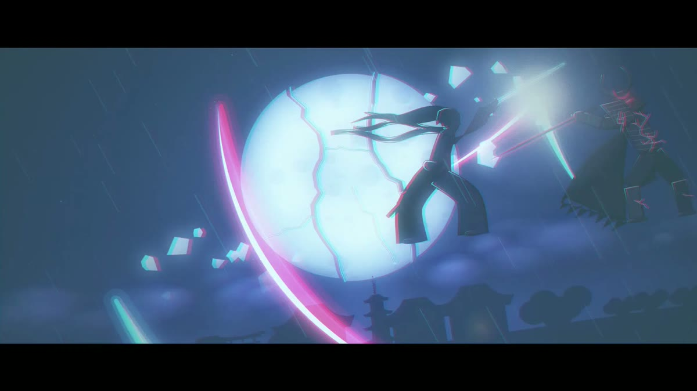
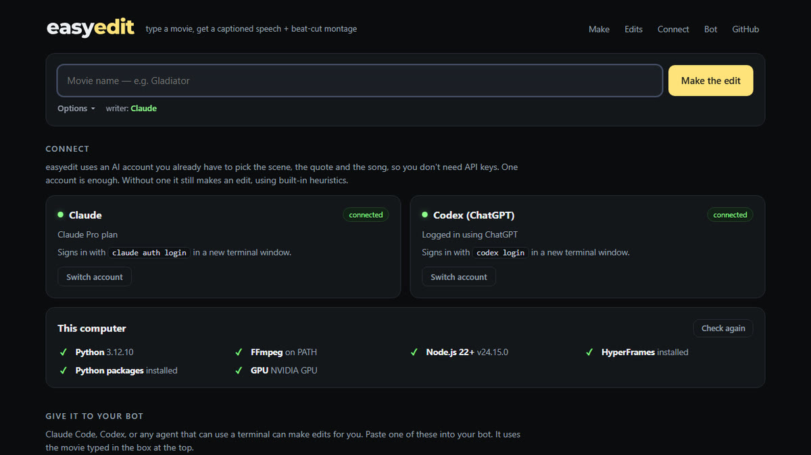
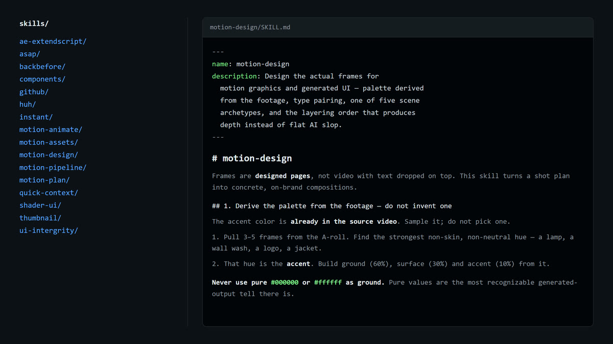
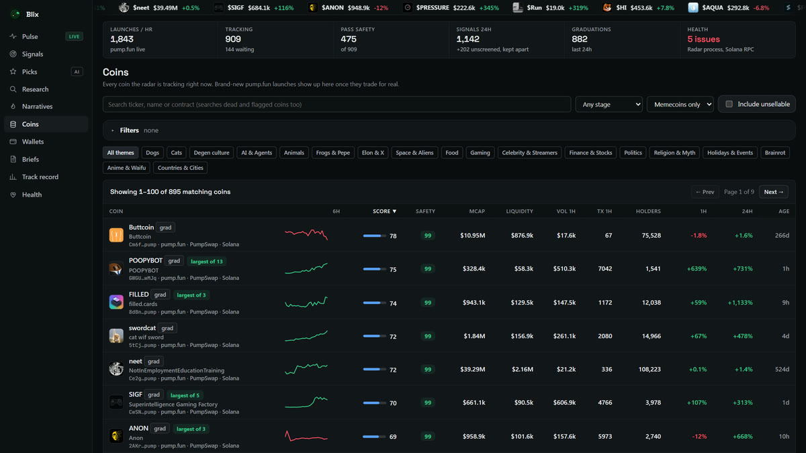

## ⭐ Main project: [BLIX](https://blixvip.com)

**[BLIX](https://blixvip.com) is an AI-powered memecoin terminal for Solana.** Every pump.fun launch live, AI coin ratings, narrative tracking, wallet and X tracking, and one-click trading, all on one screen. Trade real SOL or practise in paper mode first.

**[Start trading at blixvip.com →](https://blixvip.com)** &nbsp;·&nbsp; [Public API](https://blixvip.com/api) &nbsp;·&nbsp; [MCP server](https://blixvip.com/mcp) &nbsp;·&nbsp; [Source](https://github.com/blixvip/blixtrade)

## 🆕 New: [GenMotion](https://github.com/blixvip/GenMotion)

**Type an idea, get a finished motion-graphics video.** GenMotion writes the storyboard, paints every scene with the image model you pick (17 of them: GPT Image, Nano Banana, FLUX, Imagen, plus the top Chinese models Seedream, Qwen-Image, Kling, Wan, Hunyuan and more), animates kinetic type over it and exports a 1080p MP4. Bring your own API keys; zero dependencies.

**[Get GenMotion →](https://github.com/blixvip/GenMotion)** &nbsp;·&nbsp; [v1.0 release](https://github.com/blixvip/GenMotion/releases/tag/v1.0.0)

## Projects

<!-- projects:start -->

<table>
<tr>
<td width="50%" valign="top">

<h3><a href="https://github.com/blixvip/NullMotion">Null Motion</a></h3>

Plays a finished motion-graphics ad in sync with the rough HyperFrames drafts it grew from, so the work between them is visible. Exports the breakdown as one MP4.

★ 1.2k &nbsp;·&nbsp; <a href="https://www.nullmotion.com/">nullmotion.com</a>

</td>
<td width="50%" valign="top">

<h3><a href="https://github.com/blixvip/MotionClone">MotionClone</a></h3>

Point it at a reference video and it rebuilds the piece as an editable HyperFrames project, then plays the rebuild against the original so you can see where the timing drifts.

★ 537 &nbsp;·&nbsp; <a href="https://motionclone.lol">motionclone.lol</a>

</td>
</tr>
<tr>
<td width="50%" valign="top">

<h3><a href="https://github.com/blixvip/html-anime">html-anime</a></h3>

Turns a scene prompt into a shot sheet, then has a coding agent draw the film in HTML and CSS. No video model — the frame above is code.

★ 196 &nbsp;·&nbsp; <a href="https://blixvip.github.io/html-anime/">blixvip.github.io/html-anime</a>

</td>
<td width="50%" valign="top">

<h3><a href="https://github.com/blixvip/easyedit">easyedit</a></h3>

Type a movie name, get a fan edit: the film's best speech in animated captions, then a montage cut to the beat. Whisper for transcription, onset detection for the cuts.

★ 165

</td>
</tr>
<tr>
<td width="50%" valign="top">

<h3><a href="https://github.com/blixvip/skills">skills</a></h3>

The agent skills I use daily, as drop-in SKILL.md folders for Claude Code and Codex.

★ 5

</td>
<td width="50%" valign="top">

<h3><a href="https://github.com/blixvip/blixtrade">BLIX (blixtrade)</a></h3>

The open-source core of <a href="https://blixvip.com">BLIX</a>, the AI memecoin terminal for Solana: live pump.fun feed, holder ledgers that separate snipers from bundles, real Jupiter quotes, a public read API and an MCP server.

★ 3 &nbsp;·&nbsp; <a href="https://blixvip.com">blixvip.com</a>

</td>
</tr>
</table>

### Also

- **[thumbnail-studio](https://github.com/blixvip/thumbnail-studio)** — A minimal Windows workspace for YouTube thumbnails: ChatGPT side by side with your references, 12 design skills, and a one-click template.
- **[X Media](https://github.com/blixvip/x-media)** — Browse public X media and tweets by username in a local Next.js app. No login, no API key.
- **[GenMotion](https://github.com/blixvip/GenMotion)** — Type an idea, get a finished motion-graphics video. Top Western + Chinese image models (Seedream, Qwen-Image, Kling, FLUX, GPT Image, Imagen...), bring your own API keys.
- **[stick](https://github.com/blixvip/stick)** — Stick: free, open-source stick figure animation software for Windows, Linux and the web. Pose stickman joints, keyframe, add effects, draw, and export MP4/GIF. Opens Pivot Animator and Stick Nodes files. 27 languages.
- **[photo-editor](https://github.com/blixvip/photo-editor)** — Local photo editor for memecoin art: offline AI background removal, glowing rim light, 120 procedural backdrops and a one-click launch pack. No uploads, no API keys.
- **[trading-ui](https://github.com/blixvip/trading-ui)** — The trading layer for shadcn/ui: candlestick and depth charts, order book, DOM ladder, time and sales, order ticket, positions and blotter. Radix primitives, Tailwind tokens, copy-paste registry.
- **[phonectl](https://github.com/blixvip/phonectl)** — Drives an Android phone from your computer over adb and scrcpy: browser dashboard, CLI, and a build → screenshot → verify loop for agents.
- **[AI Broadcaster](https://github.com/blixvip/ai-broadcaster)** — Chrome extension that sends one prompt, image, or PDF to several AI chats at once and verifies each one received it.

<!-- projects:end -->

---

## About

I'm Kaihan Wasely. I build local-first tools for video work — things that run on
your own machine, with no server to sign into, no API keys to paste, and no usage
meter. Where a tool needs a model, it borrows the Codex or Claude Code login you
already have rather than asking for a new one.

The constraint I keep coming back to is that a creative tool should work offline
and leave its output in a format you can edit by hand afterwards. So the video
projects compile to plain HTML and CSS instead of a binary timeline, the editors
write files you can open in a text editor, and nothing phones home. Mostly Python
and TypeScript, with ffmpeg doing the heavy lifting.

Based in Canada. Reachable at [kaiguy432@gmail.com](mailto:kaiguy432@gmail.com)
or [@waselyyy](https://x.com/waselyyy).

[blixvip.com](https://blixvip.com) ·
[motionclone.lol](https://motionclone.lol) ·
[nullmotion.com](https://www.nullmotion.com/) ·
[Discord](https://discord.gg/zEB4VjmfSb) ·
[Kick](https://kick.com/blixvip) ·
[Twitch](https://www.twitch.tv/blixvip)

The grid above is rebuilt daily by
[`scripts/build-readme.mjs`](scripts/build-readme.mjs) — it always shows the six
repositories with the most stars, in order.
